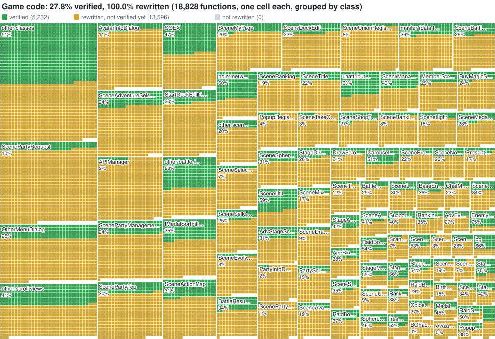
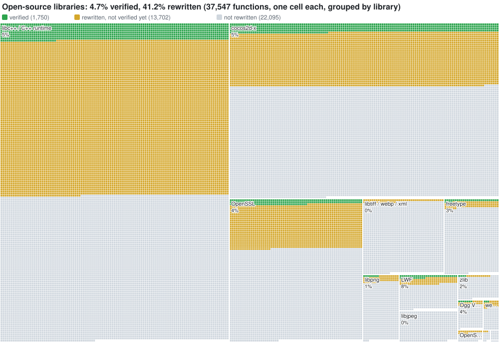

# KHUx v1.0.1: native recompilation and rewrite

AI Assisted emulation with human reversed addresses and index generation.

This repository runs the original Android native library of Kingdom Hearts Union χ v1.0.1
(`libcocos2dcpp.so`, 32-bit ARM / Thumb) on a Windows PC, and turns it into readable C++ one function at a time.

The game runs **natively**: every function of the library is translated to C and compiled into a Windows
executable, with no emulator and no Python at run time. On top of that sits the **rewrite**: hand-written C++ for
the game's code, checked against the translated original on the game's own calls while it plays. All of the
game's code has been rewritten; checking it is in progress (see [Progress](#progress)).

The game needs a compatible private server; it plays the tutorial, story quests, raids, parties and the other
online modes against one. The function addresses, names and the index the tools rely on come from manual reverse
engineering of the binary. The code that uses them was written with AI assistance.

## How it fits together

| Part | Folder | What it does |
|---|---|---|
| Analyzer | `analyze.py` | Reads the ELF and the function index: function list, ARM/Thumb modes, PLT map, switch tables, noreturn calls. Input to the lifter. |
| Lifter | `lift/` | Translates every ARM and Thumb function into C99, one C function per guest function (`lift/lifter.py`, runtime header `lift/rt.h`), and builds them into `lift.dll`. Machine-generated, register-level code. |
| Native host | `host/` | `khux.exe`: loads the library image and runs the lifted code natively. Provides what Android provided: libc, threads, files, sockets, JNI and the Java side, OpenGL ES (through ANGLE), OpenSL ES audio, text input and web views. |
| Rewrite (M3) | `rewrite/` | Readable C++ replacing lifted functions one at a time (`rewrite.dll`). A differential verifier runs each rewritten call against the lifted original and compares every result. See [rewrite/README.md](rewrite/README.md). |
| Emulator | `emu/` | Unicorn runs the original ARM code with a Python runtime. Where the project started; still the reference for the host and useful for tracing. |

All of them share the control channel on `127.0.0.1:8765` (scene, UI tree, taps, swipes, text, memory reads),
which the test scripts in `emu/` use to play the game unattended.

## Requirements

- Windows, Python 3.9 or newer
- Visual Studio 2022 with the C++ workload (MSVC): the build scripts run `vcvars64.bat` and `cl`
- ANGLE (`libEGL.dll`, `libGLESv2.dll`) next to `khux.exe` or in `emu/angle/`. Any recent Chromium-based browser
  ships them.
- A compatible private server on port 80 of `127.0.0.1`. Every hostname the game resolves is redirected there.
- For the emulator only: `pip install unicorn pyelftools capstone glfw`

## Inputs

The game files are not part of this repository. You need your own copy of the KHUx v1.0.1 APK.

```
python recomp/host/install.py <KHUx v1.0.1 APK>     # extracts the library and assets into recomp/game
```

The recompiled code is tied to one exact build of the library, so `install.py` checks its MD5 and refuses any
other. The analyzer and the function tools also read the function index from the Hex-Rays export
(`libcocos2dcpp_decompile/index.txt`, `names.txt`). Put the export and the APK in one folder and set `KHUX_INPUT`
to it, or place it at `../Input/1.0.1`; see `paths.py`.

## Building and running

```
python recomp/analyze.py                             # out/analysis.json
python recomp/lift/build.py --all --out out/lift_all # lift every function and build lift.dll
python recomp/rewrite/build.py                       # out/rewrite/rewrite.dll
python recomp/host/build.py                          # out/host/khux.exe

cd recomp && out/host/khux.exe                       # play
```

`khux.exe [--server IP] [--game DIR] [--fs DIR] [--lift DLL]`: the private server's address (default
`127.0.0.1`), the installed game files (`game/`), the device storage with saves and downloads (`fs/`, shared with
the emulator) and the recompiled game (`out/lift_all/lift.dll`).

`khux.exe` uses only the rewritten functions that passed verification (`rewrite/verified.txt`); everything else
runs as lifted C. `KHUX_REWRITE=0` runs the lifted code only, and `KHUX_RW_VERIFY=1` checks every rewritten
function on every call (slow).

The emulator runs the same game from the original ARM code:

```
python -m recomp.emu.run                # start the emulator (--fresh wipes the emulated app data first)
python -m recomp.emu.run --hybrid       # lifted C inside the emulator, checked against it
```

### Playing automatically

```
python -m recomp.emu.boot_to_title      # wait for the title screen and tap through it
python -m recomp.emu.play_quest         # play the quest or raid on screen
python -m recomp.emu.campaign 10 2400   # play quests back to back
python -m recomp.emu.ctl ui | state | events
python -m recomp.emu.step tap X Y
curl "127.0.0.1:8765/ui?all=1"
```

These work on both `khux.exe` and the emulator. [emu/AUTOMATION.md](emu/AUTOMATION.md) covers which script fits
which screen, the rush and insta-win switches, and the test cheats.

## Verifying the rewrite

```
KHUX_RW_VERIFY=1 out/host/khux.exe                  # shadow-run every rewritten call against the original
python recomp/rewrite/tools/verify_session.py N      # boot, then N quests with rush + insta-win, then merge
python recomp/rewrite/tools/merge_stats.py           # fold a session's results into status.tsv / verified.txt
python recomp/rewrite/tools/replay.py DIR            # re-check recorded calls offline, without the game
```

The verifier runs the lifted original first, then the rewrite from the same state, and compares the return
values and every byte of guest memory either one wrote. Clocks, random numbers and outside effects (server
requests, saves, sound) are recorded in the first run and replayed in the second, so nothing happens twice.
Reviewed, harmless differences (stale stack bytes the original copies) are listed in `rewrite/accepted.txt`.
Code no player can reach is checked through the control channel's `call` endpoint, which calls one function with
prepared arguments under the verifier. Details in [rewrite/README.md](rewrite/README.md).

## Layout

```
paths.py          input and output locations
analyze.py        binary analysis
progress.py       updates the Progress section below
lift/             lifter, runtime header, guest heap and stdio, build and bisect tools
host/             native host (khux.exe) and install.py
  core.c, mem.c     library image, guest memory, imports
  libc.c, fs.c      libc and the device file system (mapped into fs/)
  thread.c          guest threads on real threads
  jni.c             JNI environment and the Java side
  gl.c, sl.c        OpenGL ES (ANGLE) and OpenSL ES audio
  net.c             sockets and DNS
  ctl.c             control channel
  ui.c, webview.c   window, input, text dialog, web views
  rewrite.c         loads rewrite.dll and runs the verifier hooks
rewrite/          the rewrite: C++ sources, runtime, verifier results, tools (own README)
emu/              Unicorn emulator, Python runtime and the test-play scripts
game/             the installed game files (generated by install.py, ignored)
fs/               the emulated device storage (generated, ignored)
out/              build and analysis output (generated, ignored)
```

## Progress





```
Translation
  Decompiled              ████████████████████   99.0%  56,014 / 56,604
  Lifted                  ████████████████████  100.0%  56,381 / 56,381
  Recompiled              ████████████████████  100.0%  56,381 / 56,381

Rewrite: game code
  Rewritten               ████████████████████  100.0%  18,828 / 18,828
  Run under the verifier  ██████░░░░░░░░░░░░░░   31.9%   5,999 / 18,828
  Verified                ██████░░░░░░░░░░░░░░   27.8%   5,232 / 18,828

Rewrite: open-source libraries
  Rewritten               ████████░░░░░░░░░░░░   41.1%  15,450 / 37,547
  Run under the verifier  █░░░░░░░░░░░░░░░░░░░    5.6%   2,115 / 37,547
  Verified                █░░░░░░░░░░░░░░░░░░░    4.7%   1,750 / 37,547

Rewrite: all functions
  Rewritten               ████████████░░░░░░░░   60.8%  34,278 / 56,381
  Run under the verifier  ███░░░░░░░░░░░░░░░░░   14.4%   8,114 / 56,381
  Verified                ██░░░░░░░░░░░░░░░░░░   12.4%   6,982 / 56,381

Binary match
  1:1 binary match        ░░░░░░░░░░░░░░░░░░░░    0.0%       0 / 56,381
```

Updated by `python recomp/progress.py`.

- **Decompiled**: functions with Hex-Rays pseudocode (590 failed). Reference only.
- **Lifted**: functions the lifter translates to C (machine-generated, one C function per guest function, 65 instructions left to the emulator). 14,189 of them run and are checked against the emulator in game.
- **Recompiled**: a native executable that runs without the emulator. The native host (`host/`, Windows) runs every lifted function natively, with real threads, sound, sockets, JNI and OpenGL ES, and no emulator or Python: it plays the game through login, the main menu, quests, raids and multiplayer against the private server.
- **Rewritten**: readable C++ (named types and variables, no register-level code) in `rewrite/`. **Game code** is the game's own 18,828 functions, Square Enix's sound engine included; **open-source libraries** are the other 37,547 (cocos2d-x, libc++, OpenSSL, FreeType, libpng and others; `rewrite/tools/libsplit.py`), which a native build can take from upstream source instead.
- **Run under the verifier**: rewritten functions the game has called while the M3 verifier compared them with the lifted original.
- **Verified**: rewritten functions that matched the lifted original on every checked call. Normal play installs only these.
- **1:1 binary match**: source that rebuilds the original ARM binary byte for byte (a matching decompilation). Not started.

## Status

- **M0, analysis**: done.
- **M1, lifter**: done. Every function of the library lifts and compiles. IDA's split pieces of a function
  (fragments, Thumb-1 long-branch pieces, switch dispatch halves) are absorbed into it.
- **M2, native runtime**: done. `khux.exe` runs the whole game natively against the private server, with
  real threads, sound, sockets, JNI and OpenGL ES.
- **M3, rewrite**: all of the game's code is rewritten (October 2026). About a fifth of it has been compared
  with the original on real calls so far; the rest has either only run nested inside other rewritten functions,
  or belongs to screens and states the test sessions have not reached yet. Checking it is the current work.
  The rewrite stays faithful to the original, bugs included, down to the JNI boundary.
- **Next**: checking the rest of the rewrite. The 1:1 binary match is also done in this repository; the cleanup and refactoring of the
  rewrite (moving data off guest addresses, a platform interface in place of the JNI boundary) happen in a fork of
  this repository, so this one stays the faithful version.

## License

MIT, see [LICENSE](LICENSE). Credit is required: keep the copyright notice in copies and derived work. Game data and assets are not covered (they belong to Square Enix).
